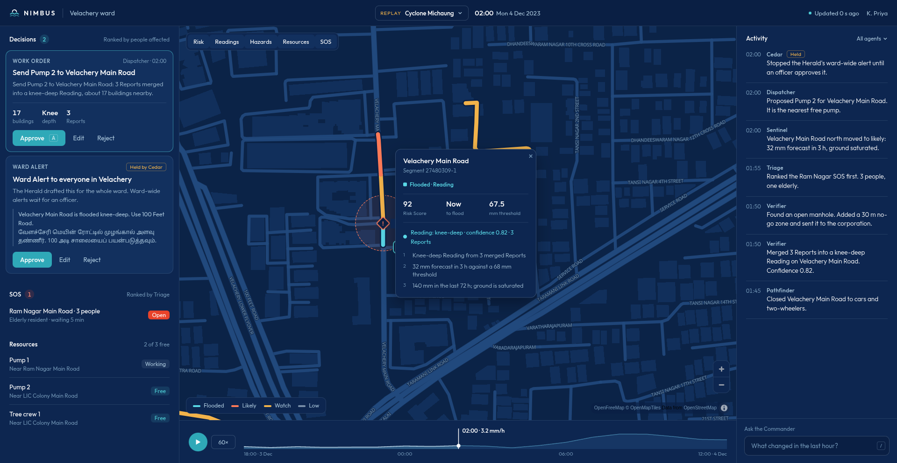

# NIMBUS

Street-level flood prediction and response for Chennai. Built for the AWS hackathon, Heat and Water track.

In December 2023, Cyclone Michaung flooded Velachery. City-wide warnings didn't say which street would flood or when to move a two-wheeler, and ward officers had no ranked picture of where pumps were needed first. NIMBUS predicts flooding **per street segment**, warns the people on that street in **English and Tamil**, and proposes **which pump goes where**. An officer approves every large action: AI proposes, a human decides.

The deployed system replays the real Michaung storm (archived Open-Meteo rain, 2–5 Dec 2023) through live AWS services.



## How it works

```
Replay Driver ──clock.tick──▶ EventBridge bus "nimbus" ◀──events── every agent
                                   │
          ┌────────────────────────┼─────────────────────────┐
          ▼                        ▼                         ▼
     Sentinel (Lambda)        Herald (Lambda)          Dispatcher (Lambda)
     scores 21 street         English + Tamil          dispatch solver picks
     segments each tick       alerts; Cedar holds      pump → street; proposes
     → risk.changed           >100 recipients as       Work Orders; Cedar lets
                              a Ward Alert Proposal    a crew move only after
                                                       an officer approves
          │                        │                         │
          └────────── projector (Lambda) → DynamoDB ◀────────┘
                                   │
                   API Gateway: console API · citizen API
                                   │
                     ward console (officer approves)
```

1. **Sentinel** scores every street segment every 15 storm-minutes with the risk engine (rain over the last 72 h plus the next 3 h, against each segment's flood threshold) and emits `risk.changed` when a band changes (`low` → `watch` → `likely`).
2. **Herald** alerts subscribers whose Saved Places are on that street, from fixed English and Tamil templates, so public safety text never contains invented facts. It points people only to streets that are entirely low risk. An alert to more than 100 people is held for an officer.
3. **Dispatcher** asks the dispatch solver which free pump should go to which at-risk street (impact over travel time) and proposes each pick as a Work Order, with the numbers behind it. On approval the pump goes `en_route`.
4. Every outward agent action is checked by **Cedar** policies (`agents/policies/nimbus.cedar`), and each decision is logged as `policy.decided` in the activity feed.

On the replay, the first street reaches `watch` at 2 Dec 17:45, about 34 hours before the first `likely` (4 Dec 03:45), and all 21 segments are `likely` by 4 Dec 07:45 (`replay/HIT_RATE.md`).

## AWS

| Service | Use |
|---|---|
| AWS Lambda (Python 3.12) | Sentinel, Herald, Dispatcher, event projector, console API, citizen API, push sender |
| Amazon EventBridge | custom bus `nimbus`, one rule per agent and event type, a 7-day archive |
| Amazon DynamoDB (on demand) | 16 tables, every row keyed by `run_id` so replays never mix with live data |
| Amazon API Gateway (HTTP APIs) | ward console and citizen app backends, throttled |
| Amazon S3, SSM Parameter Store | photos, shared configuration |
| AWS CDK (Python) | all infrastructure: `NimbusShared`, `NimbusApi`, `NimbusAgents` |

AWS open source: **Strands Agents** (the agent framework, configured for Amazon Nova) and **Cedar** (guardrails).

**Note on models:** the agents are configured for Amazon Nova (Lite for plain-language reasons, Pro for planning). Our account was on the Free plan, where Bedrock calls are not authorised, so this deployment runs the agents in rule and template mode. The Nova path is implemented and tested against a stubbed Bedrock.

## Repository

| Folder | What | Owner |
|---|---|---|
| `contracts/` | shared entities, events and fixtures; generated TypeScript and Dart models | Derrick |
| `engines/` | risk engine (`risk/`) and dispatch solver (`dispatch/`): deterministic, no AI | Goutam |
| `replay/` | Replay Driver, Run seeding, Hit Rate | Goutam |
| `agents/` | Strands agents: Sentinel, Herald, Dispatcher; Cedar policies | Vishwa |
| `api/` | projector, console API, citizen API, push sender | Varun |
| `infra/` | AWS CDK stacks | Varun, Vishwa |
| `console/` | ward console: React + MapLibre GL JS, feed, Proposal queue, risk map | Derrick |
| `app/` | citizen app: Flutter (Android), English and Tamil | Derrick |

Start with `CONTEXT.md` (domain terms), `docs/adr/` (decisions), `docs/WRITEUP.md` (submission writeup) and `docs/AI_TOOLS.md`.

## Run it

Tests (each folder is a [uv](https://docs.astral.sh/uv/) project):

```bash
cd agents && uv run pytest -q    # likewise in contracts/, engines/, replay/, api/, infra/
```

Deploy (needs AWS credentials, Node for the CDK CLI, and Docker or Podman for bundling):

```bash
cd infra
npx cdk deploy NimbusShared NimbusApi NimbusAgents   # with Podman: CDK_DOCKER=podman
```

Replay the storm:

```bash
cd replay
NIMBUS_EVENT_BUS=nimbus uv run python driver.py --run-id replay-michaung \
  --start 2023-12-04T03:00:00+05:30 --ticks 8 --speed 8
```

Run the ward console against the deployed API:

```bash
cd console && npm install
VITE_NIMBUS_API=<ConsoleApiUrl> VITE_CITIZEN_API=<CitizenApiUrl> npm run dev   # without them it runs on fixtures
```

The URLs are the `NimbusApi` stack outputs (also SSM `/nimbus/api/console-url` and `/nimbus/api/citizen-url`). You can also read the agent feed and the officer queue straight from the console API: `GET /activity?run_id=replay-michaung` and `GET /proposals?run_id=replay-michaung`. Approve with `POST /proposals/{id}/decision` (see `api/README.md`).

## Team

Vishwa Thangapandiyan (agents, AWS deployment) · Varun M (infrastructure, APIs) · Goutam Adityan (engines, Storm Replay) · Derrick Rajkumar (contracts, product design, frontend)
