<!-- The cards are animated SVGs drawn by docs/readme/build.py. Edit the script, then run it; don't edit the SVGs. -->
<div align="center">


<p>
<a href="#how-it-works"><b>How it works</b></a> ·
<a href="#the-agents"><b>Agents</b></a> ·
<a href="#built-on-aws"><b>AWS</b></a> ·
<a href="#run-it"><b>Run it</b></a> ·
<a href="docs/WRITEUP.md"><b>Writeup</b></a>
</p>


</div>

## The problem

In December 2023, **Cyclone Michaung** flooded Velachery, Chennai. City-wide warnings said "heavy rain expected". They didn't say *which street* would flood, or *when* to move a two-wheeler, an elderly parent or a shop's stock. Ward officers had the same problem in reverse: no ranked picture of where the pumps were needed first.

**NIMBUS** predicts flooding **street by street**, warns the people on that street **in English and Tamil**, and proposes **which pump goes where**. Every large action waits for a ward officer. **AI proposes; a human decides.**

<div align="center">

</div>

We don't simulate a storm. We **replay the real one**: archived Open-Meteo rain plays through the deployed system on a storm clock, and every number above comes from that run (`replay/HIT_RATE.md`).

<h2 id="how-it-works">How it works</h2>

<div align="center">

</div>

- **One bus, no direct calls.** Agents publish and react to events on Amazon EventBridge, so the same code serves a live storm and a replay. Every record carries a `run_id`, so the two never mix.
- **Deterministic where it matters.** The risk score, the dispatch ranking and the alert wording are plain, tested code. Agents explain and propose; they don't invent facts.
- **Guardrails as policy.** Every outward action is checked by [Cedar](agents/policies/nimbus.cedar), and every decision is logged as a `policy.decided` event in the officer's feed.

<h2 id="the-agents">The agents</h2>

<div align="center">



</div>

| Agent | Wakes on | Does | Guardrail |
|---|---|---|---|
| **Sentinel** | `clock.tick` | scores 21 Velachery segments with the risk engine (72 h of rain + the next 3 h against each street's flood threshold) and emits `risk.changed` when a band moves | none needed: it only predicts |
| **Herald** | `risk.changed`, `proposal.decided` | alerts subscribers on that street from fixed English and Tamil templates, and only points them to streets that are entirely low risk | Cedar holds any alert to more than 100 people as a Ward Alert Proposal |
| **Dispatcher** | the Sentinel's tick, `proposal.decided` | asks the dispatch solver which free pump goes to which at-risk street (impact over travel time) and proposes Work Orders with the numbers behind them | Cedar lets a crew move only after an officer approves |

<div align="center">

</div>

### The ward console

<div align="center">

<br><sub>The ward console (React + MapLibre GL JS) on the design scene: the decision queue, the street risk map and the live agent feed.</sub>
</div>

<h2 id="built-on-aws">Built on AWS</h2>

<div align="center">

</div>

- **Ship It:** three CDK stacks (`NimbusShared`, `NimbusApi`, `NimbusAgents`) deployed in `us-east-1`. Everything is pay-per-use, so the system costs nothing while idle, and the public APIs are throttled.
- **Build It:** [Strands Agents](https://github.com/strands-agents/sdk-python) for the agents and [Cedar](https://www.cedarpolicy.com) for the guardrails, both AWS open source.
- **Models:** the agents are configured for **Amazon Nova** (Lite for plain-language reasons, Pro for planning). Our account began on the AWS Free plan, where Bedrock calls aren't authorised, so this deployment runs the agents in rule and template mode. The Nova path is implemented and tested against a stubbed Bedrock.

<h2 id="run-it">Run it</h2>

<details open>
<summary><b>Tests</b>: each folder is a <a href="https://docs.astral.sh/uv/">uv</a> project</summary>

```bash
cd agents && uv run pytest -q    # likewise in contracts/, engines/, replay/, api/, infra/
cd console && npm test           # the ward console
```
</details>

<details>
<summary><b>Deploy</b>: AWS credentials, Node for the CDK CLI, Docker or Podman for bundling</summary>

```bash
cd infra
npx cdk deploy NimbusShared NimbusApi NimbusAgents   # with Podman: CDK_DOCKER=podman
```
</details>

<details>
<summary><b>Replay the storm</b></summary>

```bash
cd replay
NIMBUS_EVENT_BUS=nimbus uv run python driver.py --run-id replay-michaung \
  --start 2023-12-04T03:00:00+05:30 --ticks 8 --speed 8
```

Then read the agent feed and the officer queue from the console API: `GET /activity?run_id=replay-michaung` and `GET /proposals?run_id=replay-michaung`. Approve with `POST /proposals/{id}/decision` (see [`api/README.md`](api/README.md)).
</details>

<details>
<summary><b>Run the ward console against the deployed API</b></summary>

```bash
cd console && npm install
VITE_NIMBUS_API=<ConsoleApiUrl> VITE_CITIZEN_API=<CitizenApiUrl> npm run dev   # without them it runs on fixtures
```

The URLs are the `NimbusApi` stack outputs (also SSM `/nimbus/api/console-url` and `/nimbus/api/citizen-url`).
</details>

## Repository

| Folder | What |
|---|---|
| [`contracts/`](contracts) | shared entities, events and fixtures; generated TypeScript and Dart models |
| [`engines/`](engines) | risk engine and dispatch solver: deterministic, no AI |
| [`replay/`](replay) | Replay Driver, Run seeding, Hit Rate |
| [`agents/`](agents) | Sentinel, Herald, Dispatcher on Strands Agents; Cedar policies |
| [`api/`](api) | event projector, console API, citizen API, push sender |
| [`infra/`](infra) | AWS CDK stacks |
| [`console/`](console) | ward console: React + MapLibre GL JS |
| [`app/`](app) | citizen app: Flutter (Android), English and Tamil |

Start with [`CONTEXT.md`](CONTEXT.md) for the domain terms, [`docs/adr/`](docs/adr) for the decisions, and [`docs/AI_TOOLS.md`](docs/AI_TOOLS.md) for the AI tools we used.

<div align="center">


<sub>Heat &amp; Water track · built on AWS · ஒவ்வொரு தெருவுக்கும் வெள்ள எச்சரிக்கை</sub>
</div>
